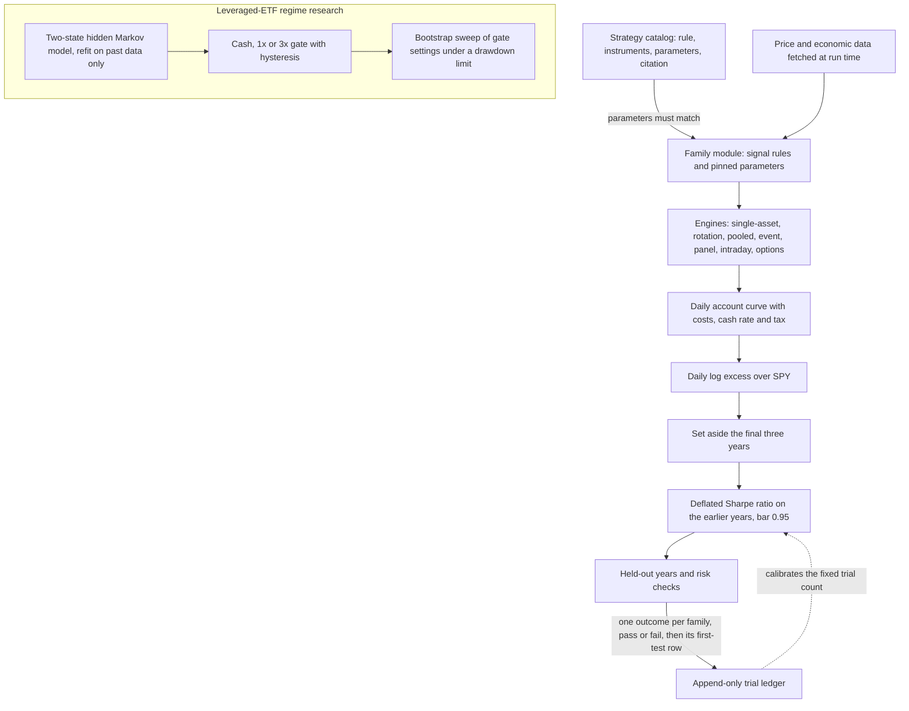

# Quant research platform

[](https://github.com/johnaadams122/quant-research-platform/actions/workflows/ci.yml)

A Python research platform for testing systematic trading ideas without fooling yourself. Each idea
(a "family") is registered in a catalog before it is tested, every test is counted in an append-only trial
ledger, and on the account-versus-index scoring path a family passes only if its deflated Sharpe ratio on
daily returns in excess of the index reaches 0.95 and it then clears a held-out confirmation and risk
checks. A second, per-trade scoring construction is also included (see
[docs/METHODOLOGY.md](docs/METHODOLOGY.md)). The same repository holds a separate line of research on
when a regime-gated 3x leveraged index fund beats holding the index itself.

It is research code. It places no orders and connects to no brokerage account.

What is here:

- `src/mining/`: the testing machinery (catalog, trial ledger, deflated Sharpe ratio, account-versus-index
  scoring, holdout split, cost gate, pooling, near-miss reports) and the engines that turn a signal into a
  daily account curve (single-asset, two-asset rotation, pooled, event, panel, intraday and options).
- `src/mining/batch5/` and `src/mining/batch6/`: one module per strategy family, holding its signal rules
  and its own pinned copy of its parameters. The run scripts that record results refuse to score a family
  whose copy differs from its catalog entry.
- `data/mining/catalog.json`: the registered families, each with its rule, instruments, parameters and a
  source citation.
- `src/regime_signal.py`, `src/hmm_guards.py`, `src/causal_backtest.py`, `src/gate_engine.py`,
  `src/objective.py`, `src/strategy_sweep.py`, `src/sweep_cache.py`: the leveraged-ETF regime research.
- `scripts/`: data-fetch scripts and the run scripts that score families. They are reference code: each
  run script reads inputs that are not published here (see Limitations).

[docs/METHODOLOGY.md](docs/METHODOLOGY.md) explains each safeguard and the module that implements it.

## Architecture



The diagram shows the account-versus-index path. The per-trade construction records a family's first
test before scoring it and reads its trial count from the ledger at run time; both are described in
[docs/METHODOLOGY.md](docs/METHODOLOGY.md).

## Setup

Use Windows 11 or Windows Server 2022 (the CI runner image) with Python 3.13. Run every command from the
repository root.

```powershell
python -m venv .venv
& ./.venv/Scripts/python.exe -m pip install -r requirements-dev.txt
$env:PYTHONPATH = (Resolve-Path ./src).Path
```

`requirements-dev.txt` installs everything: it includes `requirements.txt` (the runtime packages) and adds
`pytest` and two packages the tests use. pandas is capped below version 3 because pandas 3 changes
backtest results. Modules are imported from `src` (for example `from mining import dsr`), which is why
`src` goes on `PYTHONPATH`. `PYTHONPATH` lasts only for the current PowerShell window; set it again in a
new one.

Data-fetch scripts need settings only for the services they call (see [External services](#external-services)):
`SEC_EDGAR_USER_AGENT` for SEC EDGAR, `FRED_API_KEY` for FRED, and `ALPACA_API_KEY_ID` with
`ALPACA_API_SECRET_KEY` for Alpaca intraday bars. Nothing reads them at import time, and no default
value ships.

## Synthetic example

This scores an invented account against an invented index with the same functions the pipeline uses.
It needs no network and no data files. Save it as `example.py` in the repository root and run it with
`PYTHONPATH` set as above: `& ./.venv/Scripts/python.exe example.py`.

```python
import numpy as np
import pandas as pd

from mining import account_relative, dsr

rng = np.random.default_rng(7)
sessions = pd.bdate_range("2015-01-02", periods=1500)
benchmark = pd.Series(rng.normal(0.0004, 0.011, len(sessions)), index=sessions)
account = benchmark + rng.normal(0.0001, 0.004, len(sessions))   # benchmark plus a small noisy edge

excess = account_relative.log_excess(account, benchmark)
result = account_relative.score_account(excess, n_trials=150, sr_variance=0.0004)
print(result["reason"])
print("passes the 0.95 bar:", result["dsr_value"] >= 0.95)

# The same Sharpe ratio judged as a single trial: luck is not deflated away.
print("as one trial:", round(dsr.deflated_sharpe_ratio(
    sr=result["sharpe_daily_excess"], n=result["n_sessions"], skew=result["skew"],
    kurtosis=result["kurtosis"], n_trials=1, sr_variance=0.0004), 4))
```

Output:

```text
daily-excess DSR 0.0780 over 1500 sessions
passes the 0.95 bar: False
as one trial: 0.742
```

The trial count (150) and the spread of Sharpe ratios across trials (`sr_variance`) are made-up inputs here,
not the pipeline's values. On the account-versus-index path the pipeline uses a fixed package calibrated
from the trial ledger (`constants.ABI1_N_TRIALS` and `constants.DAILY_SR_VARIANCE`; see
[docs/METHODOLOGY.md](docs/METHODOLOGY.md)). The point of the example:
judged as a single test this edge scores 0.742, already short of 0.95, and counting the other 149 tries
cuts it to 0.078.

## Tests

Run from the repository root:

```powershell
& ./.venv/Scripts/python.exe -m pip install -r requirements-dev.txt
$env:PYTHONPATH = (Resolve-Path ./src).Path
& ./.venv/Scripts/python.exe -m pytest src/tests -q
```

The suite blocks network connections for the whole session (`src/tests/offline_guard.py`): an attempt to
connect raises an error, apart from the loopback link inside `socket.socketpair()`, which asyncio uses.
The block covers Python sockets, asyncio and the HTTP client `yfinance` uses, in the test process and in
child Python processes started the normal way, which pick it up through `PYTHONPATH`. It does not block a
plain DNS lookup or a UDP `sendto`, and it does not reach non-Python programs or Python children started
with `-I`, `-E` or `-S`; no test starts such a child. Setting `QUANT_TESTS_ALLOW_NETWORK=1` turns the
block off, in child processes too; it is never set by default. Two tests set it on purpose in child
processes, to prove the switch works; one child attempts no connection at all, and the other connects
only to `127.0.0.1` (this computer), so nothing leaves the machine. Tests that need downloaded vendor data are not part of this repository. CI runs the
same command after the declared fresh-environment dependency setup.

The documented suite uses synthetic data and mocks external services. Dependency
installation may use public package registries; tests are reviewed to run offline.
The CI badge reports the hosted workflow's status for its selected commit.

## External services

The tests contact none of these. Scripts and fetch functions call them only when you run them. Supply your
own access where needed and follow each provider's terms.

| Service | Used for | You supply |
|---|---|---|
| Yahoo Finance through `yfinance` | Daily price history for most families and the regime research | Nothing; this is an unofficial interface and can break. |
| FRED (St. Louis Fed) | Economic series (`src/mining/external_data.py`). Scoring drivers use the keyed interface, limited to series whose history is not revised; the keyless public graph download is used by no scoring driver (the spike-fade study script uses it). | `FRED_API_KEY` (a free key) for the keyed interface. That fetch stops with an error when it is unset. |
| SEC EDGAR | Company filings read by filing date | `SEC_EDGAR_USER_AGENT`: an organisation name and contact email, as the SEC fair-access policy asks. Requests stop before sending when it is unset. |
| Alpaca market data | One-minute intraday bars (`src/mining/intraday_data.py`) | `ALPACA_API_KEY_ID` and `ALPACA_API_SECRET_KEY`, read only when a request starts. |
| CFTC public reporting | Commitments of traders open interest (`src/mining/cftc_data.py`) | Nothing. |
| Kraken | Crypto spot prices and perpetual-futures funding rates (`src/mining/crypto_data.py`) | Nothing. |
| Nasdaq, TreasuryDirect, FINRA, Wikipedia and dividend-history sites | Index history, auction dates, margin-debt statistics, index member lists and dividend dates, each read by one fetch script or family | Nothing. |

Downloaded price history is cached locally and kept out of git by `.gitignore`; vendor terms do not allow
redistributing it. The repository does ship a few small public or derived data files under `data/`: the
strategy catalog, event-date lists (FOMC statement dates, CPI and payrolls release dates, and S&P 500
index additions), a market calendar, a one-date ticker list of S&P 500 and Nasdaq-100 members, a
membership list for the eleven Select Sector SPDR funds, and the CFTC open-interest history (public US
government data, with its manifest) that the commodity open-interest family reads.

## Limitations

- **Windows only.** The trial-ledger lock uses a Windows byte-range lock (`msvcrt`) and refuses to run on any
  other system. A portable lock is future work. The suite is exercised on Windows with Python 3.13 only.
- **No vendor price history ships.** Most families need a fetch run before they can be scored, and results
  depend on what the vendors return on that day.
- **The run scripts are reference code, not a one-command reproduction.** Each one reads inputs that are not
  in this repository: the trial ledger, curated candidate lists and run settings (some pinned by hash),
  the bid-ask quote samples used to measure trading costs (one small sample for the index-addition family
  ships with its event cache), and cached price history. Without them a script stops with an
  error rather than producing a result. The test suite exercises the same code with small synthetic
  inputs.
- **Results are not reproduced here.** The trial ledger and per-family results stay private; the summary
  below gives counts only.
- **Some tests stay private.** Tests that need downloaded vendor data are kept out of the public suite.
- **Not investment advice.** Research code, provided as is under the MIT license, without warranty. A family
  that passed these checks would still be a research result, not a trading recommendation.
- **Example defaults.** The cost model's tax rates and account types (`roth`, `ira`, `hsa`, `taxable`) are example
  settings for US accounts; set them for your own situation.

## How this was built

The project owner designed the architecture, wrote specifications, directed AI coding agents,
and used AI reviewers plus his own review of designs, plans and results. The code
was developed with AI assistance and review gates.

## License and security

MIT. See [LICENSE](LICENSE) and [SECURITY.md](SECURITY.md).

## Results summary

**What was tested.** The catalog registers 183 strategy families: 168 eligible for testing and 15 ruled
out with a recorded reason before testing (for example, the effect had decayed, trading costs would
consume it, or the fund it needs was closed). The families cover calendar and seasonal effects, trend
and mean reversion, cross-asset and macro regime rotations, credit and volatility regimes,
company-filing anomalies, event-driven trades, intraday and swing trades, crypto spillovers and
options-selling strategies.

**The bar.** On the account-versus-index path, a family is scored on its daily log return in excess of
SPY, including sessions in cash, after trading costs and, where the model applies them, a cash rate and
tax. It passes only if its deflated Sharpe ratio is at least 0.95, judged against a fixed trial count
calibrated from the ledger (see [docs/METHODOLOGY.md](docs/METHODOLOGY.md)), and it must then clear a
held-out final three years and risk checks. The per-trade construction judges a family's trades against a
trial count read from the ledger and a six-month holdout. In its day-trading and swing pipelines, a
short-hold strategy must first show a round-trip spread, measured from bid-ask quotes, below a ceiling and
a backtest net edge of at least three times that spread; intraday families on the account-versus-index
path are charged quote-based costs but skip that gate.

**The outcome.** 163 strategy families were scored; none passed the deflated-Sharpe bar (one early pass
was withdrawn after a stricter benchmark-relative re-test).
